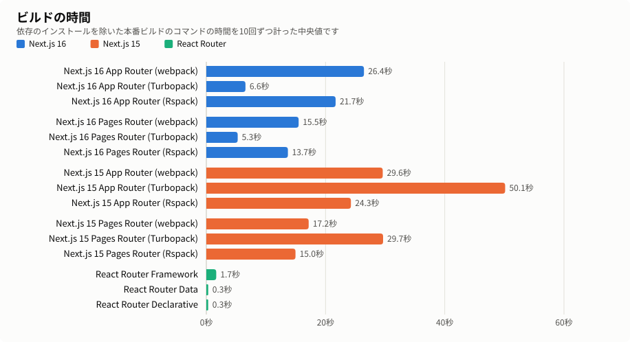
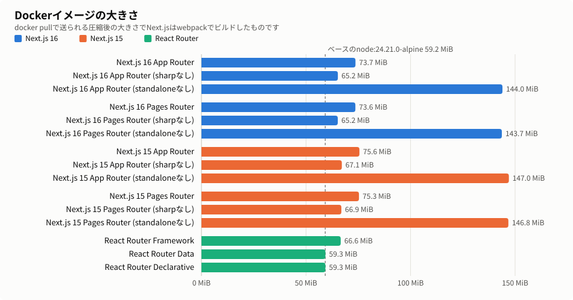

# react-framework-benchmark

同じ500個の静的なルートをNext.jsとReact Routerのいくつかの書き方で作ってビルドの時間とDockerイメージの大きさを計ったものです。

ビルドの時間は10回計った中央値でsharpありのものです。sharpなしでもほとんど変わりません。最初の列はNext.js 16とReact Routerの標準のバンドラです。Next.js 15の標準のバンドラはwebpackでTurbopackは`--turbopack`をつけたときだけ使われます。

| アプリ | Turbopack / Vite + Rolldown | Turbopack (standaloneなし) | webpack | webpack (standaloneなし) | Rspack |
| --- | --: | --: | --: | --: | --: |
| Next.js 16 App Router | 6.6秒 | 6.5秒 | 26.4秒 | 23.5秒 | 21.7秒 |
| Next.js 16 Pages Router | 5.3秒 | 5.0秒 | 15.5秒 | 11.9秒 | 13.7秒 |
| Next.js 15 App Router | 50.1秒 | 46.0秒 | 29.6秒 | 26.2秒 | 24.3秒 |
| Next.js 15 Pages Router | 29.7秒 | 25.5秒 | 17.2秒 | 12.2秒 | 15.0秒 |
| React Router Framework | 1.7秒 |  |  |  |  |
| React Router Data | 0.3秒 |  |  |  |  |
| React Router Declarative | 0.3秒 |  |  |  |  |

Dockerイメージの大きさもsharpありのものです。sharpなしにするとNext.jsはどれも8.4MiBほど小さくなります。

| アプリ | Turbopack / Vite + Rolldown | Turbopack (standaloneなし) | webpack | webpack (standaloneなし) | Rspack |
| --- | --: | --: | --: | --: | --: |
| Next.js 16 App Router | 71.2 MiB | 144.9 MiB | 73.8 MiB | 144.4 MiB | 73.8 MiB |
| Next.js 16 Pages Router | 71.3 MiB | 144.2 MiB | 73.7 MiB | 143.9 MiB | 73.7 MiB |
| Next.js 15 App Router | 75.8 MiB | 158.2 MiB | 75.8 MiB | 147.3 MiB | 75.7 MiB |
| Next.js 15 Pages Router | 75.6 MiB | 147.3 MiB | 75.4 MiB | 147.0 MiB | 75.4 MiB |
| React Router Framework | 66.6 MiB |  |  |  |  |
| React Router Data | 59.3 MiB |  |  |  |  |
| React Router Declarative | 59.3 MiB |  |  |  |  |

ビルドは依存のインストールを除いた本番ビルドのコマンドだけの時間でそれぞれ10回計った中央値です。毎回新しいコンテナで`.next`などがない状態から始めて全部の組み合わせを1回ずつ順に回すのを10周しています。大きさはイメージをレジストリにpushしたときのlinuxのマニフェストにあるconfigとレイヤーの合計なのでdocker pullで送られる量と同じです。ベースの`node:24.21.0-alpine`も含みます。sharpなしは`outputFileTracingExcludes`で`node_modules/sharp`と`node_modules/@img`を外したイメージです。standaloneなしは`STANDALONE=0`で`output: "standalone"`を外してビルドして本番用の`node_modules`と`.next`を入れて`next start`で動かすイメージです。Next.js 15は`next.config.ts`を読むのに`typescript`が要るのでそれも入れています。ビルドの時間のばらつきは`results/build-times.md`に、毎回の数字は`results/build-times.csv`にあります。大きさのバイト数は`results/benchmark.md`にありますがstandaloneなしだけは別の回に作ったイメージで`results/no-standalone.md`にあります。

どれもMac mini (Apple M4、メモリ16GB) の上で立ち上げたDev ContainerからDocker in Dockerで計っています。Dockerから見えるのは8コアと11.7GiBのメモリです。

静的なルートといってもビルドのときにHTMLを書き出すことはしていません。App Routerは`dynamic = "force-dynamic"`でPages Routerは`getServerSideProps`を使ってReact Router Framework Modeと同じくリクエストのたびにレンダリングするようにそろえています。

リポジトリのルートで`make bench`を実行するとイメージを作り直してすべて1回ずつ計り直します。ビルドの時間を10回ずつ計るのは`make repeat`で`RUNS`で回数を変えられます。止まっても`results/build-times.csv`にある分から続けます。standaloneなしだけなら`sh scripts/bench.sh no-standalone`です。グラフは`make charts`で作り直せます。

- [Next.js 16 App Router](apps/next/README.md)
- [Next.js 16 Pages Router](apps/next-pages/README.md)
- [Next.js 15 App Router](apps/next-15/README.md)
- [Next.js 15 Pages Router](apps/next-pages-15/README.md)
- [React Router Framework Mode](apps/react-router/README.md)
- [React Router Data Mode](apps/react-router-data/README.md)
- [React Router Declarative Mode](apps/react-router-declarative/README.md)
- [Laravel](backend/README.md)
- [Varnish](varnish/README.md)

| 名前            | バージョン                      |
| --------------- | ------------------------------- |
| Next.js 16      | 16.4.0                          |
| Next.js 15      | 15.5.27                         |
| next-rspack     | 16.4.0 / 15.5.27                |
| React Router    | 8.4.0                           |
| Vite / Rolldown | 8.3.4 / 1.2.13                  |
| React           | 19.3.0                          |
| Node.js         | 24.21.0 (`node:24.21.0-alpine`) |
| Varnish         | 7.7                             |
| Laravel / PHP   | 13.35.0 / 8.4.26                |
| MySQL           | 8.4.11                          |

## Varnish

App Routerでもページごとのキャッシュができることを確かめるために`benchmark-next:cache-demo`の前にVarnishを置いています。`make varnish-verify`のログは`results/varnish.md`にあります。

静的なHTMLは`s-maxage=31536000`で2回目からHITになります。動的なHTMLは`public, s-maxage=60`でURLごとにHITになります。`?_rsc`の付いたRSCはHTMLとは別のものとしてHITになり`_rsc`のないRSCのリクエストはPASSです。`/dynamic/1`は`Page 1`と`Benchmark page 1`を返し`/dynamic/501`は404のHTMLを返して2回目からHITになります。
